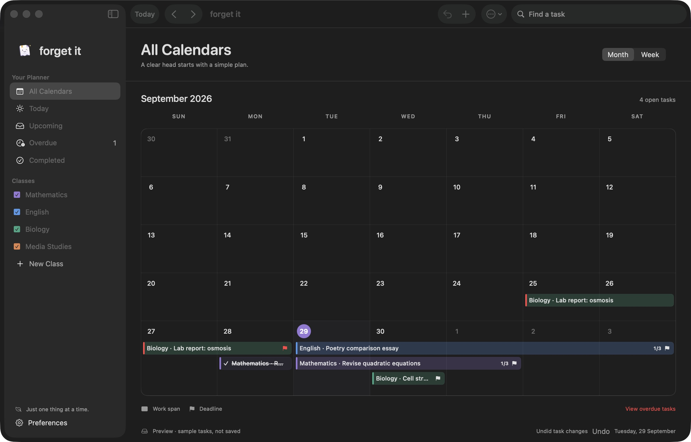

# forget it

A calm, native macOS homework planner. Version 0.2 targets **macOS 26 or later on Apple Silicon** and uses SwiftUI, AppKit, and UserNotifications. No third-party packages, network calls, account, AI runtime, or model downloads are required.



The source code is here; downloadable DMGs belong in [GitHub Releases](https://docs.github.com/en/repositories/releasing-projects-on-github/managing-releases-in-a-repository). See [PUBLISHING.md](PUBLISHING.md) for the first upload. The current DMG is a local development build, ad-hoc signed and not notarized.

## Run

For a source build, run `bash scripts/build-app.sh`, then open `dist/forget it.app`. On first launch, choose your default reminder schedule (including no reminders), then create a class and add tasks. Use ⌘N for a task, ⇧⌘N for a class, ⌘T to return the calendar to today, and ⌘, for Preferences.

Task dates are explicit calendar buttons. Browsing months never changes the value; selecting a day closes the picker.

The app is locally ad-hoc signed, not Developer ID signed or notarized. The DMG is a development build for local testing, not a public release.

## Build

Requires Swift 6.2 and the macOS 26 SDK (Xcode or Command Line Tools).

```sh
bash scripts/build-brand.sh  # Regenerate icons and downloadable artwork
bash scripts/build-app.sh
bash scripts/build-app.sh --dmg
bash scripts/test.sh
```

You can also open `Package.swift` in Xcode. Launch the packaged app to exercise notifications; the notification framework requires a valid app bundle. The test script compiles a standalone assertion runner so it also works with Command Line Tools without Xcode's test frameworks. Run the app with `--preview` for in-memory sample tasks; this mode never writes planner data or schedules notifications.

## Included

- Named, coloured classes with descriptions; edit a class using its context menu.
- All Calendars and individual class views, with class visibility toggles.
- Month/week calendar, continuous work-span bars, collision lanes, and deadline flags.
- Task editing, notes, local attachments, completion dates, all-day deadlines, and multi-part progress.
- Today, Upcoming, Overdue, Completed, and search views.
- Default and per-task reminders, including daily-from-one-week-before and custom lead time/time of day.
- Explicit choice to continue daily reminders for seven days after a deadline.
- Native local notifications; edits and completion replace/cancel pending alerts.
- Atomic local persistence, JSON backup/export, validated restore, and recovery copies before restore.
- Light/dark appearance, native navigation materials, keyboard entry, accessibility labels, and increased-contrast bar outlines.

## Homework, revision, and work days

Choose **Homework** for a task that finishes once, or enable **Split into parts** for several sessions. Each check completes one part; the whole calendar span disappears only after the final part. The task stays in Completed.

Choose **Revision** to track individual study days. Clicking a day within its calendar bar opens that particular study day. Completing it crosses out only that day; future days remain active. By default there is one session for every included day in the work span. An optional session target, such as three sessions, finishes the revision after that many distinct study days. Completed days remain visible; unused future days are removed. Each study day can count only once.

**Work days** offers Every Day, Weekdays Only, Weekends Only, and individual weekday toggles. Exclusions break the calendar bar and skip daily reminders; a real deadline on an excluded day is still shown with a dashed deadline entry. A fixed revision target cannot exceed the available days in the span.

**All day** hides the time field and treats the deadline as the end of the chosen day. Reminder presets expose a separate all-day reminder time. Timed deadlines keep their precise time.

Use the toolbar or footer **Undo** button to reverse recent planner changes, including accidental completion or deletion. Option-Command-Z also undoes a planner change; normal text-field undo is left to macOS. The current app session retains the last 20 planner changes. In the task editor, progress is a draft until Save Changes, and individual sessions have Undo buttons.

## Logo artwork

The folded-paper mascot is drawn from a shared vector source in `Sources/ForgetIt/BrandArtwork.swift`. The sidebar, task editor, onboarding, Preferences, app icon, and exported files use the same drawing. Running `bash scripts/build-brand.sh` creates `dist/forget-it-logo.zip` with a 2048-pixel app icon, a transparent mascot PNG, a vector PDF, and the ICNS file.

## Storage and reminders

Version 0.2 reads version 0.1 planners and saves version 2 data. Before the first update of a version 1 file, it keeps `planner-before-v0.2.json` beside the planner. Existing tasks default to Homework; change them to Revision where appropriate.

Data is stored at `~/Library/Application Support/ForgetIt/planner.json`. Attachments are embedded in backups; each file is limited to 20 MB. Backups are not encrypted. Use File → Export Backup regularly.

Reminder times follow the local calendar/time zone. One-day/three-day presets use the deadline's time of day. Daily/custom schedules use the selected reminder time and exclude times already passed. The earliest 60 upcoming alerts are queued; the queue refreshes when the app activates or data changes. Users with more than 60 scheduled alerts must periodically reopen the app. macOS permission and Focus determine delivery and presentation. No background AI or polling service runs.

## Scope and remaining work

This is the first manual/offline version described by the design brief. Optional Vision/Ollama assignment import, model installation UI, and real-device AI benchmarks are not implemented. A task details sheet is used rather than a persistent inspector. Apple Calendar sync and lesson timetables are intentionally outside this version.

Before public distribution: exercise real notification delivery and opening a task from a banner, verify long-running behaviour and accessibility with the owner's settings, sign with Developer ID, notarize, and test the DMG on another Mac. No GitHub release is published by the build script.

## Design references

The implementation uses native system navigation and a legible content layer, following Apple's [macOS guidelines](https://developer.apple.com/design/human-interface-guidelines/designing-for-macos/), [Liquid Glass adoption guide](https://developer.apple.com/documentation/TechnologyOverviews/adopting-liquid-glass), and [materials guidance](https://developer.apple.com/design/human-interface-guidelines/materials). Notifications use Apple's [local notification APIs](https://developer.apple.com/documentation/usernotifications/scheduling-a-notification-locally-from-your-app).
